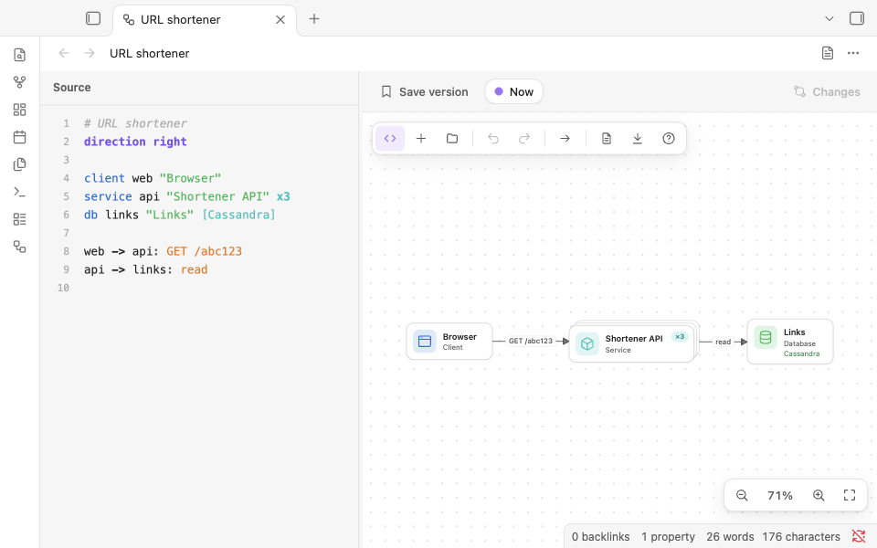
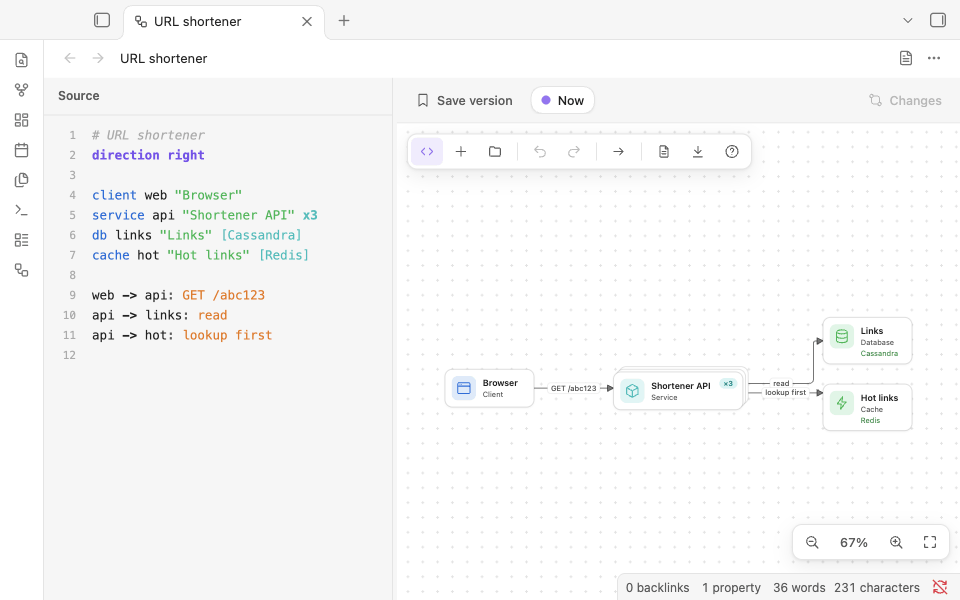
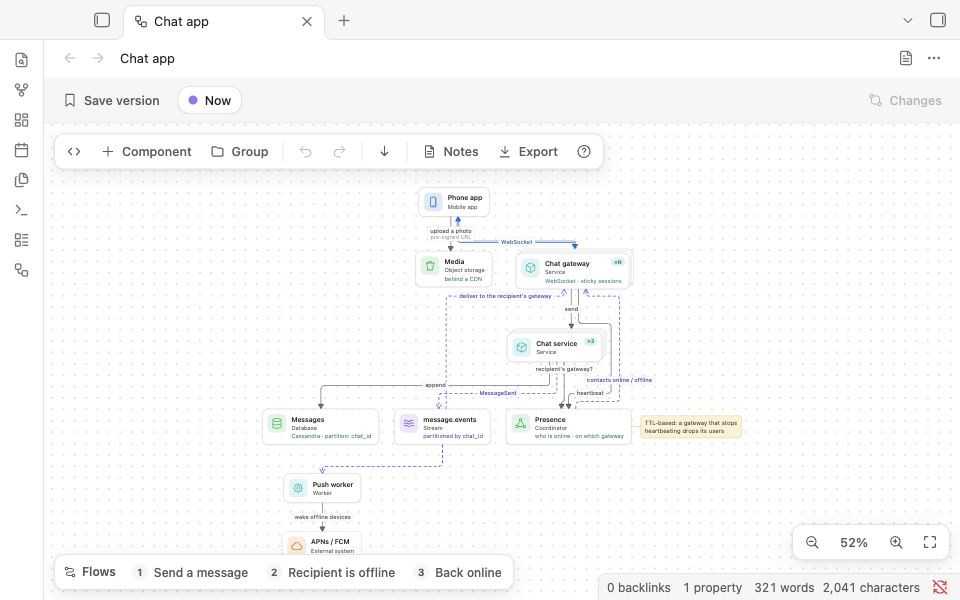
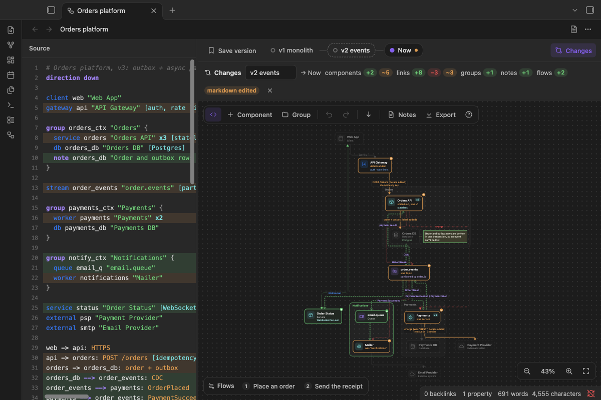
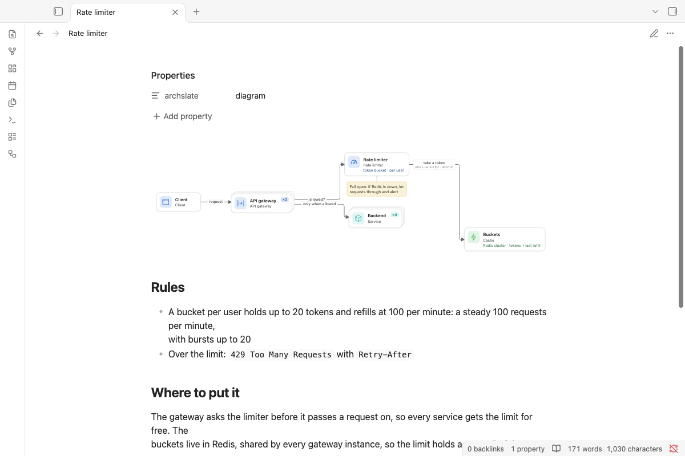

# Archslate

**Your diagram is text: edit it by typing or by clicking, save versions, and see exactly what changed.**

Draw system design diagrams from a few lines of text or by clicking. Each diagram is a Markdown note with a code
block.

<p align="center">
  
</p>

Archslate keeps a diagram as a small, readable language in a code block: `service api "Orders API" x3`,
`api -> db: write`, `api --> events: OrderPlaced`. The source and the canvas are two views of the same text, so
typing a line draws a box, and clicking (+) on the canvas writes the line for you. Layout is automatic. Save a
version before you change the design, and the **Changes** view shows what was added, removed and changed since.
Requirements, estimates and trade-offs go below the diagram as ordinary Markdown, in the same note.

## Features

- **Text and canvas, one diagram.** Type in the source and the canvas follows; click, drag a link or rename on the
  canvas and the source follows. An edit rewrites only the lines it touches, so comments and ordering stay.
- **Made for system design.** 22 component types (clients, gateways, rate limiters, services, workers, databases,
  caches, queues, topics, streams, warehouses, coordinators...), and three kinds of link: requests (`->`), events
  (`-->`) and open connections such as WebSockets (`<->`). `x3` or `xN` shows a component that runs as several
  copies; `[Postgres, sharded by user_id]` puts the details that matter under its name; a `note` sticks a remark
  beside it.
- **Versions and changes.** Save a named version at any step (Cmd/Ctrl+S). **Changes** compares the diagram with a
  version: added in green, removed in red, changed in orange with what it was ("scaled out, was ×3",
  "was request"). Open any version read-only, or restore it; restoring never loses your current work.
- **Walk through a flow.** `flow checkout "Place an order" { ... }` lists the steps of one request; select it and
  the steps are numbered, the rest dims, and the view follows the path. Press W for the next flow.
- **Your notes, in the same note.** Everything below `---` in the source is Markdown, shown rendered beside the
  diagram by Obsidian itself: links, tags, tables, callouts.
- **A note like any other.** In reading view and live preview the code block is drawn as the diagram. Search,
  links, Sync and git see a Markdown note. Opening a note as a diagram never changes it.
- **Edits from elsewhere show up.** A change from Obsidian Sync, git or another app reloads the open diagram, and
  Undo brings back what you had.
- **Each diagram as you left it.** Zoom, pan, the source pane's width and the notes panel are kept for every note.
- **Export.** PNG or SVG of exactly what is on screen (a version, the changes, a flow), in your theme, saved to your
  attachment folder.
- **Your theme, your devices.** Light or dark, your accent colour. On phones and tablets: Undo, Redo and Fit in the
  view's header.
- **Diagrams from your AI agent.** An agent skill teaches Claude, or another agent, to write these notes
  ([For AI agents](#for-ai-agents)).
- **Also in your browser.** The same editor runs as a web page, [Archslate on the web](https://wilsonneto-swe.github.io/archslate-obsidian/),
  and opens and saves the same notes. Nothing leaves the browser.

<p align="center">
  
  
</p>

<p align="center">
  
  
</p>

## How it compares

Obsidian draws `mermaid` code blocks itself, and several plugins draw diagrams. The table sets out what each one
says about itself in the [community directory](https://community.obsidian.md/plugins) (read on November 7, 2026);
"—" means it doesn't say.

| | A diagram is | Edit by clicking | Edit as text | Versions and a visual diff | Made for |
| --- | --- | --- | --- | --- | --- |
| **Archslate** | A code block in a Markdown note | Yes | Yes, side by side, both ways | Yes, kept in the note | System design |
| Mermaid (built into Obsidian) | A code block in a Markdown note | — | Yes | — | Many kinds of diagram |
| [Excalidraw](https://community.obsidian.md/plugins/obsidian-excalidraw-plugin) | An Excalidraw drawing | Yes | — | — | Drawing anything |
| [Diagrams](https://community.obsidian.md/plugins/drawio-obsidian) | A Draw.io diagram | Yes | — | — | — |
| [D2](https://community.obsidian.md/plugins/d2-obsidian) | D2 text ("a modern diagram scripting language") | — | Yes | — | — |
| [PlantUML](https://community.obsidian.md/plugins/obsidian-plantuml) | PlantUML text | — | Yes | — | — |

The others also do things Archslate doesn't: Excalidraw and Draw.io draw freely, anything you like; Mermaid, D2 and
PlantUML cover many more kinds of diagram (sequence, class, entity-relationship).

## Getting started

### Open a note as a diagram

- **New diagram**: the command **Archslate: New diagram**, the diagram button in the ribbon, or right-click a
  folder in the file explorer and choose **New diagram**. It opens with a small example to change.
- **A note you are in**: **Archslate: Open as diagram**, or **Open as diagram in a split** to keep the Markdown
  beside it. Right-clicking the note (in the file explorer, in its text, or the tab's **⋯** menu) offers it too.
- **Back to Markdown**: the page button in the view's header, **⋯ > Open as Markdown**, or **Archslate: Open as
  Markdown**.
- **Always as a diagram**: **Archslate: Always open this note as a diagram** adds `archslate: diagram` to the note's
  properties; new diagrams have it already. **Archslate: Stop always opening this note as a diagram** takes it out
  again (the palette offers whichever of the two applies), and the note's right-click menu has a checkbox for it. A
  tab where you choose **Open as Markdown** keeps that note as Markdown while the tab is open, and comes back the
  same way after a restart.
- **A diagram inside a note**: **Archslate: Insert diagram** puts an `archslate` code block at the cursor. It is drawn
  in reading view and live preview, and the button on its corner opens the note as a diagram. The editor works on
  the first `archslate` block at the note's top level, so only that block gets the button; one inside a callout or a
  list is drawn but not edited.
- More commands: **Save a version**, **Show changes against the previous version**, **Walk through the next flow**,
  **Show or hide the source**, **Show or hide the notes**, **Fit the diagram to the view**, **Export as PNG** and
  **Export as SVG**. Give any of them a hotkey in **Settings > Hotkeys**.

### The language

````text
direction down                               # or right

client web "Web app"                         # <type> <id> ["Label"]
gateway api "API gateway" [auth, rate limits]
service orders "Orders" x3 [stateless]       # x3: three copies; xN: many
db orders_db "Orders DB" [Postgres]

group payments "Payments" {                  # a box; groups nest
  worker charge "Charger" x2
}

note orders_db "Order and outbox rows commit together"

web -> api: HTTPS [10k QPS]                  # ->  request: the caller points at the callee
api -> orders: POST /orders
orders --> charge: OrderPlaced               # --> event: points the way the data goes
web <-> api: WebSocket                       # <-> open connection

flow checkout "Place an order" {             # numbered steps over links declared above
  web -> api: submit
  api -> orders
}
---
## Notes
Markdown from here on: requirements, estimates, trade-offs.
````

Types: `client` `mobile` `user` `dns` `cdn` `lb` `gateway` `ratelimiter` `service` `worker` `function` `cron`
`db` `cache` `storage` `search` `warehouse` `coordinator` `queue` `topic` `stream` `external`. Every rule is in
[skills/system-design-diagram/reference/FORMAT.md](skills/system-design-diagram/reference/FORMAT.md). A typo never
invents a component: a link to an unknown name is reported at its line, and the rest of the diagram still draws.

### Keys

| Key | What it does |
| --- | --- |
| Tab / Shift+Tab | Add a component after / before the selected one, linked to it |
| Drag a (+) | Link to an existing component |
| L | Link from the selection: click a target, or arrows then Enter |
| Enter | Rename the component, or edit the link's label or the note |
| T / D / N | Change the type / instances and details / add a sticky note |
| E / R | Cycle request → event → connection / reverse the link |
| Delete or Backspace | Delete the selection (a group keeps its contents) |
| Arrow keys | Move the selection |
| A / G | Add a component / a group |
| W | Walk through the next flow |
| C | Show the changes against the previous version |
| M / \\ | Show or hide the notes / the source |
| Cmd/Ctrl+S | Save a version |
| Cmd/Ctrl+Z, Shift+Cmd/Ctrl+Z | Undo, redo |
| F / 0 | Fit the diagram / zoom to 100% |
| ? | Every key, on the canvas |

The source pane is a plain editor with its own keys (Tab indents, Enter keeps the indent). Obsidian's shortcuts keep
working: Cmd/Ctrl+P, Cmd/Ctrl+O, Cmd/Ctrl+W and the others.

### What a diagram looks like as a note

````markdown
---
archslate: diagram
---

```archslate
direction right
client web "Browser"
service api "Shortener API" x3
cache hot "Hot links" [Redis]
db links "Links" [Cassandra]
web -> api: GET /abc123
api -> hot: lookup first
api -> links: read
```

## Requirements
- Redirect in under 20 ms (p99)

%% archslate:versions
{"name":"with cache","createdAt":"2026-11-07T12:00:00.000Z","id":"…","text":"…"}
%%
````

The block holds the diagram; the notes after it are Markdown; the saved versions sit in a comment at the end (one
line each, hidden in reading view). Opening a note never writes it. When you edit the diagram, Archslate rewrites the
block, and the versions when you save one; the properties and any text around the block stay, with the note's line
endings (blank lines at the very end of the note are not kept). Text added after the versions comment, such as a
footnote, is read as notes, and the next save moves the comment back to the end.

More diagrams to open are in [`examples/`](examples): a URL shortener, a chat app, a rate limiter, and an orders
platform in three versions. Copy the folder into your vault; each note opens as a diagram.

## For AI agents

The agent skill in [`skills/system-design-diagram`](skills/system-design-diagram) teaches an AI agent (Claude Code,
the Claude apps, or any agent that reads instructions) to write these diagrams in your vault: the language, what
makes a good system design diagram, and how to change a diagram without breaking it. Its command-line tool is built
from Archslate's own parser and file format, so a note it writes is exactly what the plugin reads; `validate` prints
the outline the diagram will show, with each problem at its line in the note, and `version` saves the current
diagram before a big change.

Install it in Claude Code by copying the folder into your skills folder, then start a new session:

```
git clone --depth 1 https://github.com/wilsonneto-swe/archslate-obsidian.git
mkdir -p ~/.claude/skills && cp -R archslate-obsidian/skills/system-design-diagram ~/.claude/skills/
```

Then ask, for example: "Design a URL shortener in my Obsidian vault, with the read path as a flow." For the Claude
apps and other agents, see [skills/README.md](skills/README.md). The skill is not part of the plugin: Obsidian never
loads it, and the plugin's releases do not include it.

## Installation

- **From Community plugins** (once it is listed): Settings > Community plugins > Browse, search for "Archslate",
  then select **Install** and **Enable**.
- **Manually**: download `main.js`, `manifest.json` and `styles.css` from the
  [latest release](https://github.com/wilsonneto-swe/archslate-obsidian/releases/latest) into
  `<vault>/.obsidian/plugins/archslate/`, reload Obsidian, then enable **Archslate** in Settings > Community
  plugins.
- **On your phone**: install it from Community plugins there too, or let Obsidian Sync bring it (turn on
  "Installed community plugins" and "Active community plugin list" in Settings > Sync on both devices).

Archslate needs Obsidian 1.7.2 or later and runs on desktop (macOS, Windows, Linux) and mobile (iOS, iPadOS,
Android). It has been tested with Obsidian 1.14.5 on macOS and in Obsidian's mobile emulation.

## Privacy

Archslate works offline. It makes no network requests, has no telemetry or ads, and needs no account. It reads and
writes only the notes you open as diagrams (and the notes its commands create or flag), writes exported images into
your attachment folder, and keeps each diagram's zoom and panels in the plugin's own folder (`data.json`). It never
reads or writes files outside your vault.

## Building from source

This repository holds the plugin and the web version; they share one editor.

```
npm install
npm run build:obsidian     # apps/obsidian/dist: main.js, manifest.json, styles.css
npm run check              # Obsidian's lint rules, the tests, both builds, a scan for private data
npm run dev                # the web version from the sources: http://localhost:5173/apps/web/
```

The plugin's code is in `apps/obsidian/src`; `packages/core` is the language, the layout, the routing of links and
the file format, and `packages/ui` is the editor (canvas, source pane, versions); `apps/web` is the web version;
`skills/` holds the agent skill, outside the build. To try a build, run
`npm run build:obsidian -- --vault "<path to a test vault>"`: it copies the three files into that vault's
`.obsidian/plugins/archslate/`. Releases are built by GitHub Actions when a version tag is pushed
(`.github/workflows/release.yml`), with build attestations. [CONTRIBUTING.md](CONTRIBUTING.md) covers reporting a
bug and sending a pull request; [docs/](docs) covers the architecture, the tests and releasing.

## Feedback

**Which system design question would you like to draw next, and what got in the way?** Tell us in
[Discussions](https://github.com/wilsonneto-swe/archslate-obsidian/discussions), where questions and ideas are welcome
too.

Found a bug? [Open an issue](https://github.com/wilsonneto-swe/archslate-obsidian/issues/new/choose). Pull requests
are welcome too: [CONTRIBUTING.md](CONTRIBUTING.md) explains how.

## Sponsor

Archslate is free, works offline and has no ads or accounts. If it is useful to you, you can support its development
on [GitHub Sponsors](https://github.com/sponsors/wilsonneto-swe).

## License

MIT, see [LICENSE](LICENSE).

## More plugins by the author

- [Mindslate](https://community.obsidian.md/plugins/mindslate): open a note as a keyboard-first mind map and edit it
  in place; the note stays an ordinary heading with a nested list.
- [Plain Deck](https://community.obsidian.md/plugins/plain-deck): study flashcards written in your notes, with spaced
  repetition (FSRS); each review is saved in the same note, so your progress syncs with the vault.
