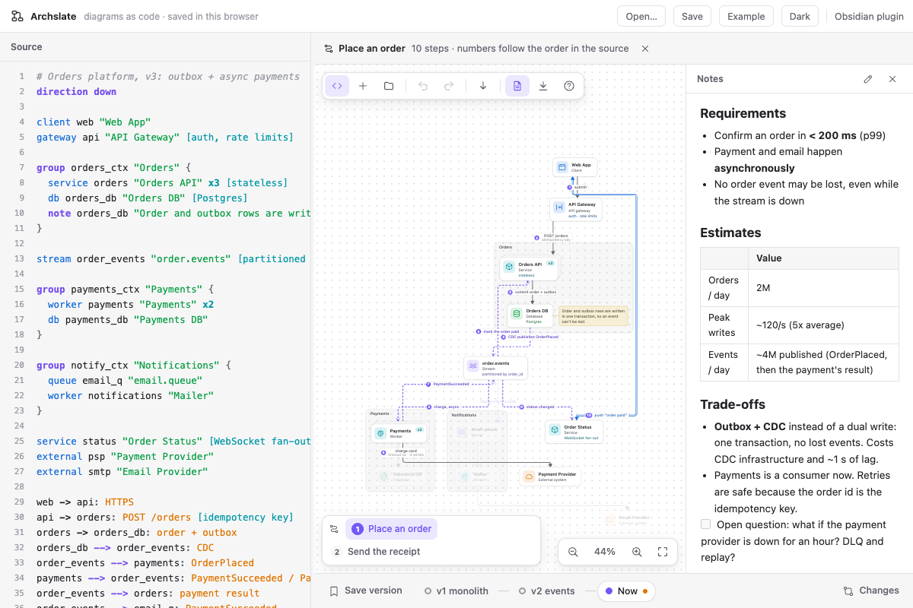

# apps/web: Archslate on the web

The editor as a plain web page, published on GitHub Pages: https://wilsonneto-swe.github.io/archslate-obsidian/



- Everything runs in the page. The diagram is kept in the browser's `localStorage`; nothing is uploaded, and the page
  makes no requests to any other host (its Content-Security-Policy forbids it).
- Several tabs share the one diagram: a change in one shows up in the others, and a tab left open never writes over
  newer work. If the stored diagram ever fails to open, it is set aside and offered as a download, and the example
  opens instead.
- **Open…** (or drag a file onto the page) reads a diagram note (`.md`), a bare source file, or an older JSON
  backup. **Save** downloads the diagram as the same Markdown note the Obsidian plugin keeps, with every saved
  version, so a diagram goes back and forth between the two.
- **Example** puts the example back; the theme button switches light and dark.

| Path | What it is |
| --- | --- |
| `index.html` | The page, with its Content-Security-Policy |
| `src/main.js` | The host: storage, open, save, drag and drop |
| `src/theme.js` | Picks the theme before the first paint |
| `src/shell.css` | The page around the editor, and Obsidian's theme variables in light and dark |
| `src/example.js` | The example diagram and its versions |

```
npm run dev          # http://localhost:5173/apps/web/ (the sources, no build)
npm run build:web    # apps/web/dist, what GitHub Pages serves (refuses a page without its CSP)
```
